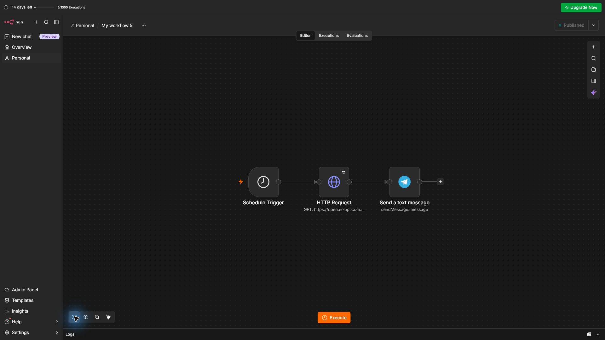
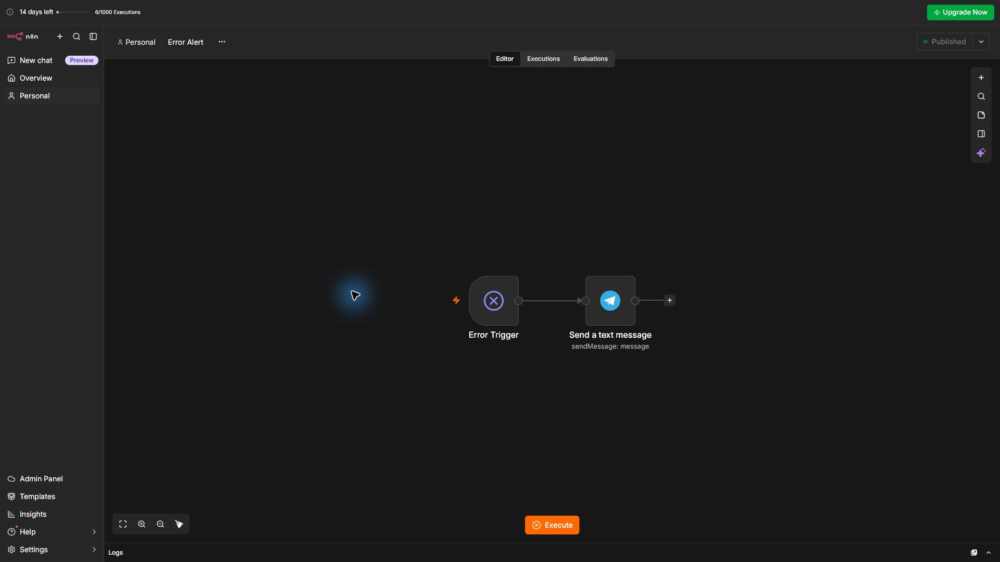

# 05 — Daily Currency Rates to Telegram (n8n)

Scheduled automation that fetches live exchange rates every morning and posts them to Telegram, with a separate error-alert workflow.

**Error Alert workflow:** Error Trigger → Telegram (workflow name + error message)

## How it works
1. **Schedule Trigger** runs daily at 09:00.
2. **HTTP Request** calls the public API `open.er-api.com` (base USD) with automatic retry on failure.
3. **Telegram** sends a formatted message with USD → VND, KZT, RUB.
4. **Error Alert** (companion workflow, see `error-alert.json`) is set as the Error workflow and notifies me in Telegram if any run fails.

## Skills shown
REST API integration, scheduling, retry logic, error handling (Error Trigger), Telegram Bot API.

## Setup
1. Import `workflow.json` and `error-alert.json`.
2. Connect your Telegram credentials in both workflows.
3. Replace `YOUR_TELEGRAM_CHAT_ID` with your Chat ID in both workflows.
4. Open the currency workflow → **Settings → Error workflow** → select the imported **Error Alert**.
