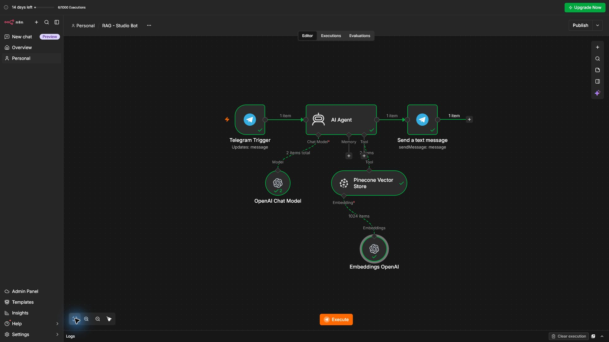

# RAG Knowledge-Base Chatbot (n8n + Pinecone + OpenAI)

A Telegram assistant for **Melay Studio** that answers client questions using only the studio's own knowledge base, with no made-up answers.

## How it works
1. **Ingestion** (separate workflow): a Google Doc with services, timelines, process and FAQ is split into chunks, embedded with OpenAI `text-embedding-3-small` (1024 dims) and stored in a **Pinecone** vector index.
2. **Telegram Trigger**: a client sends a question.
3. **AI Agent** (OpenAI chat model) decides when to search the knowledge base, using the **Pinecone Vector Store** as a retrieval tool.
4. The agent answers from the retrieved context. If the answer isn't in the base, it sends the client to the owner on Telegram instead of guessing.
5. **Telegram** sends the reply.

**Example:** "How long does a website take?" → "Building a website takes 2 to 6 weeks..."

## Stack
n8n · OpenAI (chat + embeddings) · Pinecone · Google Docs · Telegram Bot API

## What I learned
- RAG architecture: ingestion vs. retrieval, embeddings, vector search.
- Why in-memory vector stores don't persist, and moving to a real vector DB.
- Matching embedding dimensions between the model and the index (1024).
- Debugging an index type mismatch (integrated-embedding vs. vector index).

## Setup
Import `workflow.json` into n8n, then add your own OpenAI, Pinecone and Telegram credentials (none are included).
