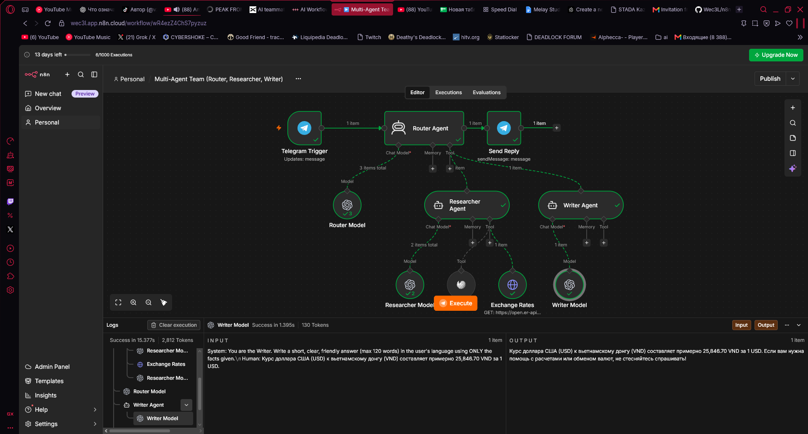

# Multi-Agent Team in n8n (Router → Researcher + Writer)

A Telegram assistant built as a small **team of AI agents** that delegate work to each other.

## How it works
1. **Telegram Trigger**: the user asks a question.
2. **Router Agent** (team lead) plans the task and delegates:
   - **Researcher Agent** gathers facts with its own tools (Wikipedia, live exchange-rate API).
   - **Writer Agent** turns those facts into a short, friendly final answer.
3. The Router returns the Writer's answer, and **Telegram** sends it.

Each agent has its own model, system prompt and tools. Agents are connected as tools of the Router (n8n *AI Agent Tool*), so the Router decides when to call each specialist.

## Stack
n8n · OpenAI `gpt-4o-mini` · AI Agent + AI Agent Tool nodes · Wikipedia tool · REST API · Telegram Bot API

## What I learned
- Multi-agent orchestration: a router or supervisor pattern with specialist agents.
- Splitting responsibilities (research vs. writing) to reduce hallucinations.
- Passing data between agents with `$fromAI()` parameters.
- Giving each agent only the tools it needs.

## Setup
Import `workflow.json` and add your own OpenAI and Telegram credentials (none are included).
