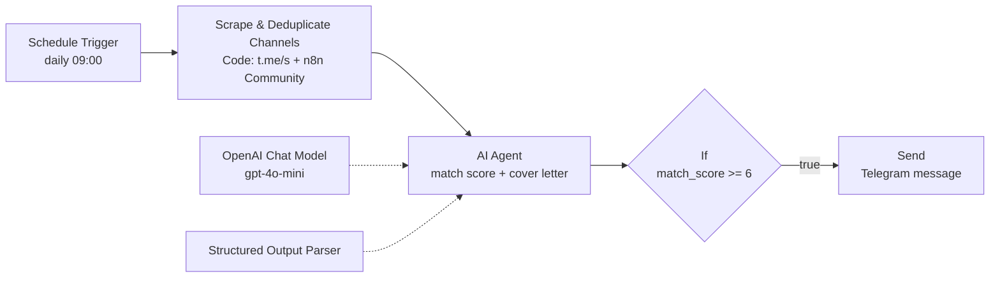

# AI Job Radar (Telegram Channels Scraper & AI Matcher)

A scheduled n8n workflow that scans public Telegram job channels and the n8n Community job board every day, filters posts by keywords, lets an AI agent score each vacancy against a candidate profile, and sends the good matches to Telegram with a short summary and a draft cover letter.

## How it works
1. **Schedule Trigger**: runs once a day at 09:00 (workflow timezone).
2. **Scrape & Deduplicate Channels** (Code node, JavaScript):
   - Gets the n8n Community jobs category (`community.n8n.io/c/jobs/13.json`). It skips pinned topics and topics with "referral" in the title, and takes at most 2 new posts.
   - Scrapes the public web preview (`t.me/s/<channel>`) of 4 Telegram channels: `betting_job`, `robotaua_now_remote`, `opento_igaming`, `iGaming_work`. It parses the last 15 messages of each channel and strips the HTML.
   - Keeps only posts with at least 60 characters that contain at least one **keyword** (e.g. n8n, automation, AI agent, RAG, support, VIP, account manager, retention, CRM, React, frontend) and none of the **stop words** (e.g. affiliate, media buyer, SEO, nutra, cold calls).
   - Remembers post IDs it has already seen in workflow static data (it keeps the last 400), so each post is processed only once. It returns at most 5 posts per run.
3. **AI Agent** (OpenAI `gpt-4o-mini`): scores each vacancy from 1 to 10 against the candidate profile and target roles in the prompt. If the post requires a language the candidate does not speak, the score is capped at 3. The agent also writes a short summary and a draft reply in the vacancy's language that includes a portfolio link.
4. **Structured Output Parser**: forces a JSON response with the fields `is_match`, `category`, `match_score`, `role_title`, `url`, `summary_ru` and `cover_letter`.
5. **If**: passes only vacancies with `match_score >= 6`.
6. **Send** (Telegram): sends a formatted message to your chat with the score, category, role, link, summary and draft cover letter.

> The AI prompt and the Telegram message template are in Russian, because the original version was built for my own job search. You can translate them; the logic does not depend on the language.

## Stack
n8n · Schedule Trigger · Code node (JavaScript, `this.helpers.httpRequest`, `$getWorkflowStaticData` for deduplication) · Telegram public channel web preview (`t.me/s/...`) · n8n Community (Discourse) JSON API · AI Agent node + OpenAI `gpt-4o-mini` · Structured Output Parser · If node · Telegram Bot API

## What I learned
- Scraping public Telegram channels without the Telegram API, using the `t.me/s/` web preview.
- Deduplicating between runs with workflow static data.
- Cheap keyword and stop-word pre-filtering before calling the LLM, to save tokens.
- Getting reliable, typed JSON from an agent with a Structured Output Parser.

## Setup
1. Import `workflow.json` into n8n.
2. Add your own **OpenAI** credential to the *OpenAI Chat Model* node and your **Telegram Bot** credential to the *Send* node (no credentials are included).
3. In the *Send* node, replace `YOUR_CHAT_ID` with your Telegram chat ID.
4. In the *AI Agent* prompt, replace `YOUR_NAME`, `YOUR_LOCATION`, the skills and target roles with your own profile, and set `YOUR_PORTFOLIO_URL` (also used in the *Structured Output Parser* example).
5. Optional: edit the `channels`, `keywords` and `stopWords` lists in the *Scrape & Deduplicate Channels* Code node, and the score threshold in the *If* node.
6. Activate the workflow.

Note: deduplication uses workflow static data, which n8n saves only for production (active) runs, not for manual test runs.
